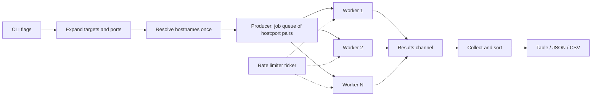

# portscout

[](https://github.com/kelvinngeno/portscout/actions)

A fast, dependency-free TCP port scanner written in Go. It finds open ports on
hosts you are authorised to test, identifies the service behind each one, and
outputs results in a form that is easy to read or pipe into other tools.

> **Intended use:** only scan systems you own or have explicit written
> permission to test. Unauthorised scanning may be illegal in your jurisdiction.

## Features

- **Concurrent** worker pool: hundreds of ports probed in parallel
- **Flexible targets:** hostnames, IPs and CIDR blocks (up to /16)
- **Flexible ports:** `80`, `1-1024`, `22,80,443`, `top`, `all`
- **Service detection:** port-to-service mapping plus live banner grabbing
- **TLS fingerprinting:** protocol version and certificate CN on TLS ports
- **Rate limiting** to keep scans gentle on fragile networks
- **Closed vs filtered:** tells "nothing listening" apart from "firewalled"
- **Output formats:** table, JSON, CSV (or write to a file with `-o`)
- **Graceful Ctrl+C:** stops cleanly and prints partial results
- **Zero third-party dependencies**; builds to a single static binary

## Install

```bash
go install github.com/kelvinngeno/portscout/cmd/portscout@latest
```

Or build from source:

```bash
git clone https://github.com/kelvinngeno/portscout
cd portscout
go build -o portscout ./cmd/portscout     # use portscout.exe on Windows
```

## Usage

```bash
portscout [flags] <target> [target...]
```

| Flag | Default | Description |
|------|---------|-------------|
| `-p` | `top` | Ports: `80`, `1-1024`, `22,80,443`, `top`, `all` |
| `-timeout` | `800ms` | Per-connection timeout |
| `-workers` | `200` | Concurrent workers |
| `-rate` | `0` | Max new connections per second (0 = unlimited) |
| `-banner` | `true` | Grab banners / TLS info from open ports |
| `-all` | `false` | Also show closed and filtered ports |
| `-format` | `table` | `table`, `json` or `csv` |
| `-o` | stdout | Write results to a file |
| `-version` | | Print version |

### Examples

```bash
# Common ports on one host
portscout scanme.nmap.org

# A port range, JSON output
portscout -p 1-1024 -format json 192.168.1.10

# A whole subnet, gently
portscout -p 22,80,443 -rate 100 10.0.0.0/24

# Save CSV for a spreadsheet
portscout -p top -format csv -o results.csv 192.168.1.10
```
Example output (scanning localhost with a test web server running):

```
HOST       PORT  STATE  SERVICE   LATENCY  BANNER
127.0.0.1  135   open   msrpc     10.6ms
127.0.0.1  445   open   smb       9.9ms
127.0.0.1  8000  open   http-alt  9.9ms    HTTP/1.0 200 OK | Server: SimpleHTTP/0.6 Python/3.13.15
```

## How it works



1. **Connect scan.** For each `host:port`, the scanner completes a full TCP
   handshake. If it succeeds the port is *open*; a refusal (RST) means
   *closed*; no reply before the timeout means *filtered*. This needs no
   special privileges, unlike raw-socket SYN scans.
2. **Worker pool.** A producer goroutine pushes jobs into a channel and a fixed
   number of workers drain it. The pool size bounds resource use no matter how
   many ports you scan.
3. **Rate limiting.** One shared `time.Ticker` hands out a "permit" per
   connection, so the limit applies across all workers.
4. **Context cancellation.** Every blocking operation selects on
   `ctx.Done()`, so Ctrl+C unwinds all goroutines without leaks.
5. **Banner grabbing.** On open ports, TLS ports get a handshake (version and
   cert CN are reported), HTTP ports get a `HEAD /` request, and everything
   else is simply listened to for a greeting (SSH, FTP, SMTP, etc. announce
   themselves). Banners are sanitised, since they are remote-controlled data.
6. **One DNS lookup per host**, not per port.

## Project layout

```
cmd/portscout/        CLI: flag parsing, wiring, exit codes
internal/scanner/     scanning engine (no CLI or I/O concerns)
internal/output/      table, JSON and CSV renderers
```

The engine is a plain Go package with a `Config` in and `[]Result` out, so it
can be reused by other tools (see the roadmap).

## Development

```bash
make test      # go test -race ./...
make cover     # coverage report
make lint      # golangci-lint
make cross     # Linux, macOS and Windows binaries in dist/
```

Tests use local listeners, so they need no internet access.

## Limitations

- TCP only (no UDP) and connect scans only (no SYN/stealth scans)
- Banner detection is heuristic; some services will not reveal anything
- IPv4 CIDR expansion only goes up to /16 by design

## Roadmap

- [ ] Progress bar
- [ ] UDP probes for DNS/SNMP
- [ ] Service fingerprint rules loaded from a YAML file
- [ ] Reusable library API and a `pkg/` export
- [ ] Prebuilt release binaries via GoReleaser

## License

MIT, see [LICENSE](LICENSE).
